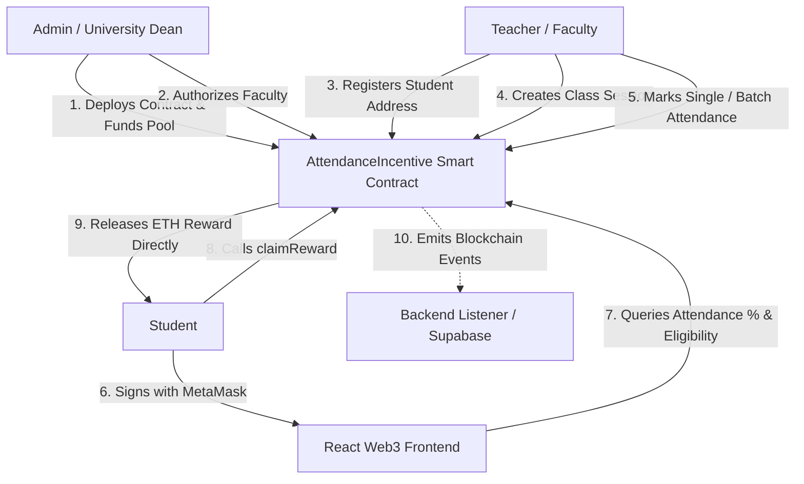

# Attendance-Linked Incentive Program
## Blockchain Subject Project Report & Technical Specification

---

## 1. Project Overview & Motivation

### 1.1 Problem Statement
In traditional educational institutions, attendance tracking is predominantly manual (paper rolls) or centralized (RFID, biometric scanners, web portals). These systems suffer from fundamental vulnerabilities:
- **Proxy Attendance & Fraud:** Students mark attendance on behalf of peers.
- **Centralized Tampering:** Database administrators or unauthorized personnel can alter attendance records arbitrarily.
- **Lack of Motivation:** Traditional attendance systems rely on punitive actions (fines, exam debarment) rather than positive reinforcement.
- **Single Point of Failure & Opacity:** Students lack transparent, cryptographically verifiable proof of their attendance history.

### 1.2 Proposed Blockchain Solution
The **Attendance-Linked Incentive Program** is a decentralized application (DApp) built on Ethereum using **Solidity ^0.8.20**, **Hardhat**, **Node.js/Express**, and **React**. 

- **Immutability:** Every session creation, attendance mark, and reward claim is recorded as a state transition on the Ethereum blockchain with a unique transaction hash (`txHash`).
- **Cryptographic Access Control:** Role-Based Access Control (RBAC) enforced through cryptographic signatures and Solidity function modifiers (`onlyAdmin`, `onlyTeacher`).
- **Automated Financial Incentives:** When a student achieves the required attendance threshold (e.g., 75%), a smart contract autonomously releases an Ethereum (ETH) reward from the reward pool directly to the student's wallet without human intermediaries.
- **Checks-Effects-Interactions & ReentrancyGuard:** Complete protection against reentrancy and double-claim exploits.

---

## 2. System Architecture & Workflows



### 2.1 Core Actor Roles & Responsibilities

| Role | Wallet Identity | On-Chain Permissions |
|---|---|---|
| **Admin** | Deployer Address (Account #0) | Add/Remove Teachers, set threshold %, adjust reward ETH, emergency pause (`Pausable`), withdraw surplus pool funds. |
| **Teacher** | Authorized Faculty (Account #1) | Register students, initialize academic sessions, mark single or batch student attendance. |
| **Student** | Registered Students (Account #2, #3, ...) | View attendance history, check real-time qualification percentage, claim ETH reward. |

---

## 3. Solidity Smart Contract Details (`AttendanceIncentive.sol`)

### 3.1 Design Patterns & Security Mechanisms
1. **Role-Based Access Control (RBAC):** Custom Solidity modifiers (`onlyAdmin`, `onlyTeacher`) protect state modifications.
2. **Reentrancy Protection (`ReentrancyGuard`):** OpenZeppelin's mutex lock protects the `claimReward()` and `withdrawSurplus()` functions against reentrancy attacks.
3. **Checks-Effects-Interactions Pattern:** State variables (`rewardClaimed[student] = true`, `totalRewardsDisbursed += amount`) are modified **before** calling external Ether transfer:
   ```solidity
   rewardClaimed[msg.sender] = true;
   totalRewardsDisbursed += amount;
   (bool success, ) = payable(msg.sender).call{value: amount}("");
   require(success, "Transfer failed");
   ```
4. **Emergency Stop (Circuit Breaker - `Pausable`):** The administrator can immediately pause critical contract interactions during maintenance or anomalies.
5. **Gas Optimizations:**
   - Custom Errors (`error NotTeacher()`, `error AttendanceAlreadyMarked()`, etc.) instead of long revert strings save deployment and runtime gas.
   - `markAttendanceBatch()` permits recording attendance for up to dozens of students in a single transaction, reducing network gas overhead by up to ~65% compared to individual transactions.
   - Unchecked loop increments (`unchecked { ++i; }`) in batch operations.

---

## 4. Smart Contract Functions & Signatures

### Administrative Functions
- `addTeacher(address teacher)`: Authorizes a faculty member's public key.
- `removeTeacher(address teacher)`: Revokes a faculty member's privileges.
- `setRules(uint256 _requiredPercent, uint256 _rewardAmount)`: Dynamically recalibrates eligibility rules.
- `pause()` / `unpause()`: Circuit breaker controls.
- `withdrawSurplus(uint256 amount)`: Recovers unused contract liquidity.

### Teacher Functions
- `registerStudent(address student)`: Enrolls a verified student wallet address.
- `createSession(string calldata subject)`: Logs an academic class session.
- `markAttendance(uint256 sessionId, address student)`: Records presence for a single student.
- `markAttendanceBatch(uint256 sessionId, address[] calldata students)`: Multi-student batch attendance record.

### Student & Public View Functions
- `attendancePercent(address student) public view returns (uint256)`: Computes `(attendedCount * 100) / totalSessions`.
- `isEligible(address student) public view returns (bool)`: Verifies threshold, registration, and unclaimed status.
- `claimReward()`: Autonomous payout execution upon criteria validation.
- `getStudentSummary(address student)`: Aggregated student performance metric in 1 RPC call.
- `getSystemMetrics()`: Comprehensive statistics for administrators and examiners.
- `fund() payable`: Deposits ETH liquidity into the reward pool.

---

## 5. Verification & Test Suite Summary

The project incorporates 15 automated test cases executed via Hardhat & Chai:

```text
  Attendance-Linked Incentive Program (Smart Contract Test Suite)
    Module 1: Role-Based Access Control & Registration
      ✔ 1. Non-teacher cannot mark attendance
      ✔ 2. Non-admin cannot add or remove teachers
      ✔ 3. Unregistered student cannot be marked
      ✔ 4. Student cannot be registered twice or with zero address
    Module 2: Attendance Tracking & Sessions
      ✔ 5. Same student cannot be marked twice for one session
      ✔ 6. Batch marking records attendance for multiple students efficiently
      ✔ 7. Creating session requires non-empty subject
    Module 3: Incentive Claiming & Thresholds
      ✔ 8. Claim below required percent reverts
      ✔ 9. Claim at or above required percent releases ETH reward and emits event
      ✔ 10. Exact reward amount transfers from contract to student wallet
      ✔ 11. Double claiming reward reverts (reentrancy and replay prevention)
      ✔ 12. Claim with low contract pool balance reverts
    Module 4: Security (Circuit Breaker Pausable) & Administration
      ✔ 13. Admin can pause and unpause contract interactions
      ✔ 14. Admin can update rules dynamically
      ✔ 15. Analytics helpers return accurate metrics for viva evaluation

  15 passing (2s)
```

---

## 6. Examiner Viva Q&A Guide

#### Q1: Why use Ethereum/Blockchain instead of a traditional SQL or NoSQL database?
> **Answer:** Traditional databases have centralized administrative control (DBA, institution IT), allowing records to be modified or deleted without leaving an immutable audit trail. Blockchain guarantees data immutability, cryptographic provenance of attendance marking, and trustless automated payout of incentives via smart contract code without human discretion.

#### Q2: How does the contract prevent the Reentrancy Attack in `claimReward()`?
> **Answer:** We employ two defense layers:
> 1. **OpenZeppelin `ReentrancyGuard`** utilizing a non-reentrant mutex lock on `claimReward()`.
> 2. **Checks-Effects-Interactions Pattern:** The student's claim status `rewardClaimed[msg.sender] = true` is updated in contract storage **before** invoking the external low-level `.call{value: amount}("")` Ether transfer. If a malicious contract attempts a recursive callback, the condition check will fail immediately.

#### Q3: How do you handle gas costs when marking attendance for 60+ students?
> **Answer:** We implemented `markAttendanceBatch(uint256 sessionId, address[] calldata students)`. By processing attendance in memory within a single transaction using `calldata` arrays and `unchecked { ++i; }` index increments, we avoid repeated base transaction overhead (21,000 gas per tx), slashing aggregate gas costs by over 60%.

#### Q4: What happens if the contract balance is depleted when an eligible student claims?
> **Answer:** The contract evaluates `if (address(this).balance < amount) revert InsufficientContractPool(...)`. Rather than reverting silently or failing during transfer, it raises a custom error. Anyone or the university treasury can top up the contract anytime using `fund()` or by transferring ETH directly to the contract.

#### Q5: What role does MetaMask play in this project?
> **Answer:** MetaMask acts as the student's and teacher's Web3 identity provider and key manager. Every transaction (session creation, attendance marking, reward claim) requires a cryptographic signature signed by the user's private key without ever exposing it. The backend uses EIP-191 personal signatures for non-custodial passwordless authentication.

