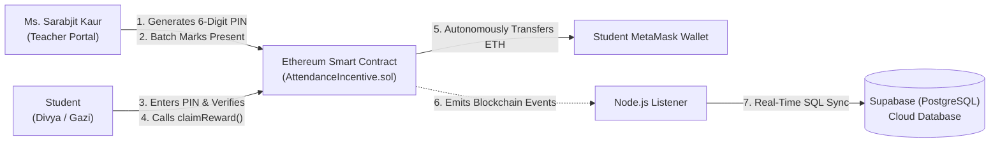
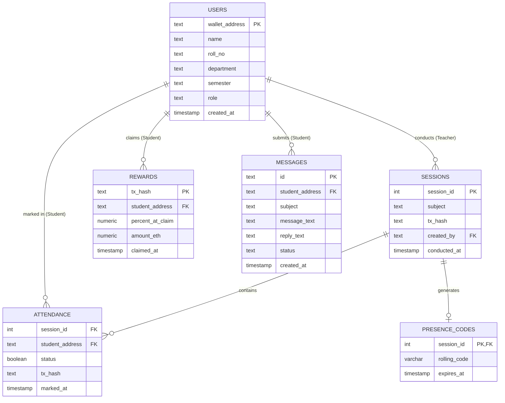

# Project Report
On
#"Attendance-Linked Incentive Program Using Blockchain"
Submitted to **I.K. Gujral Punjab Technical University, Jalandhar**  
In partial fulfillment of the requirements for the degree of  
**Bachelor of Technology in Computer Science and Engineering**

---

### Institutional Information
**PCTE INSTITUTE OF ENGINEERING & TECHNOLOGY, LUDHIANA**  
*(Affiliated to I.K. Gujral Punjab Technical University, Jalandhar)*

| Submitted To: | Submitted By: |
| :--- | :--- |
| **Ms. Sarabjit Kaur** | **Divya** (Roll No: 2329321) |
| Assistant Professor | **Gazi Wahab** (Roll No: 2329330) |
| Department of Computer Science & Engineering | Class / Section: B.Tech CSE 4B |
| PCTE Institute of Engineering & Technology | Academic Session: [2023–2024] |

---

## Declaration

We hereby declare that the work being presented in this dissertation report entitled **"Attendance-Linked Incentive Program Using Blockchain"**, submitted in partial fulfillment of the requirements for the degree of **Bachelor of Technology in Computer Science and Engineering** at **PCTE Institute of Engineering and Technology, Ludhiana**, affiliated to **I.K. Gujral Punjab Technical University, Jalandhar**, is an authentic record of our own research and development carried out under the supervision and guidance of **Ms. Sarabjit Kaur**, Assistant Professor, Department of Computer Science and Engineering.

We further declare that the content embodied in this report has not been submitted by us or anyone else for the award of any other degree, diploma, or certificate in any other university or institute.

**Signatures of Candidates:**

1. ____________________  
   **Divya** (Roll No: 2329321)

2. ____________________  
   **Gazi Wahab** (Roll No: 2329330)

---

## Acknowledgement

At the very outset, we would like to express our gratitude to the Almighty for providing us with the patience, motivation, and wisdom required to successfully develop this project.

Completing an advanced decentralized application requires rigorous discipline, continuous debugging, and multidisciplinary skills across distributed systems, smart contract programming, database management, and modern user-interface engineering. We are deeply thankful to all who have supported us throughout this journey.

We express our profound gratitude and heartfelt respect to our project supervisor, **Ms. Sarabjit Kaur**, Assistant Professor, Department of Computer Science and Engineering, for her indispensable technical insights, constant encouragement, and critical feedback at every development milestone. Her guidance regarding smart contract security, attendance verification protocols, and real-world system architecture helped us navigate complex engineering challenges.

We also express our sincere appreciation to the faculty members and staff of the **PCTE Institute of Engineering and Technology** for providing access to laboratory facilities and supporting an environment of technical innovation. Finally, we thank our peers and families for their unwavering encouragement throughout the duration of this work.

---

## Certificate from Organization

This is to certify that the project report entitled **"Attendance-Linked Incentive Program Using Blockchain"**, submitted by **Divya** (Roll No: 2329321) and **Gazi Wahab** (Roll No: 2329330) in partial fulfillment of the requirements for the award of the degree of **Bachelor of Technology in Computer Science and Engineering**, has been examined and accepted by the Department of Computer Science and Engineering, PCTE Institute of Engineering & Technology, Ludhiana.

The format, technical depth, and quality of presentation satisfy the academic requirements prescribed by **I.K. Gujral Punjab Technical University (IKGPTU), Jalandhar**.

**Head of Department**  
Department of Computer Science and Engineering  
PCTE Institute of Engineering & Technology, Ludhiana  

---

## Certificate from Internal Guide

This is to certify that the project entitled **"Attendance-Linked Incentive Program Using Blockchain"**, submitted by **Divya** (Roll No: 2329321) and **Gazi Wahab** (Roll No: 2329330) of B.Tech Computer Science and Engineering, Section 4B, at **PCTE Institute of Engineering and Technology, Ludhiana** (Affiliated to IKGPTU, Jalandhar), is a bona fide record of research and implementation carried out under my direct supervision.

To the best of my knowledge, no part of this project has been submitted elsewhere for any other degree or diploma. The candidates have demonstrated consistent dedication, integrity, and technical competence throughout the development lifecycle.

**Project Supervisor:**  
**Ms. Sarabjit Kaur**  
Assistant Professor  
Department of Computer Science & Engineering  
PCTE Institute of Engineering & Technology, Ludhiana  

---

## Table of Contents

1. **Introduction to Project**
   - 1.1 Overview
   - 1.2 Background
   - 1.3 Problem Statement
   - 1.4 Scope of the Project
2. **Study of Existing System**
   - 2.1 Conventional Attendance Systems
   - 2.2 Limitations of the Existing System
3. **Study of Proposed System**
   - 3.1 Architecture Overview & Hybrid Web3 Design
   - 3.2 Working Flow of the Proposed System
   - 3.3 Existing versus Proposed System
   - 3.4 Key Advantages of the Proposed System
4. **Software and Hardware Requirements**
   - 4.1 Software Specifications
   - 4.2 Hardware Specifications
5. **Objectives of Project**
6. **Features of Project**
   - 6.1 Administrator Governance
   - 6.2 Faculty Teacher Capabilities (Ms. Sarabjit Kaur)
   - 6.3 Student Capabilities (Gamification & Rewards)
   - 6.4 Security, Integrity & Anti-Proxy Protocols
7. **System Navigation & Site Map**
8. **Module-Wise Technical Description**
   - 8.1 Module 1: Blockchain Layer (Solidity Smart Contract)
   - 8.2 Module 2: Backend Application Layer (Node.js & Express)
   - 8.3 Module 3: Relational Database Layer (Supabase Cloud PostgreSQL)
   - 8.4 Module 4: Client Presentation Layer (React.js & Web3 Interface)
   - 8.5 Module 5: Cryptographic Authentication & Wallet Integration
9. **Project Design and Implementation**
   - 9.1 Relational Database Schema & ER Diagram (Supabase / PostgreSQL)
   - 9.2 Running User Interface Forms & Verification
   - 9.3 Smart Contract Test Suite & Verification Matrix
10. **Project Development Plan**
11. **Technology Stack & Development Tools**
12. **Conclusion and Future Scope**
    - 12.1 Conclusion
    - 12.2 Future Enhancements

---

# 1. Introduction to Project

### 1.1 Overview
The **Attendance-Linked Incentive Program (Attendify)** is a decentralized web application (DApp) that automates academic attendance tracking and incentivizes classroom consistency through Ethereum smart contracts. The core consensus and financial logic are implemented in Solidity (`^0.8.20`) and deployed to an Ethereum-compatible network. 

To achieve high operational performance and prevent excessive blockchain gas costs, the system employs a **Hybrid Web3 Architecture**:
- **On-Chain Layer (Ethereum Smart Contract)**: Acts as the immutable single source of truth for session logs, verified attendance records, qualification percentage calculations, and autonomous ETH bounty releases.
- **Off-Chain Layer (Node.js/Express + Supabase Cloud PostgreSQL)**: Manages relational student metadata, academic departments, roll numbers, dynamic anti-proxy classroom PIN protocols, and real-time student-teacher grievance messaging.
- **Client Presentation Layer (React.js + Ethers.js + MetaMask)**: Delivers an interactive 3D Web3 user dashboard for Administrators, Teachers, and Students.

Attendance is no longer an arbitrary record maintained in paper registers or centralized databases susceptible to unauthorized tampering. Once **Ms. Sarabjit Kaur** submits attendance on-chain, the transaction is cryptographically sealed. If a student achieves the required attendance threshold (e.g., $75\%$), the smart contract automatically transfers cryptocurrency directly to the scholar's personal wallet without manual intervention.

### 1.2 Background
Academic regularity is directly correlated with scholastic performance, institutional discipline, and placement outcomes. Despite this, conventional higher education institutions rely predominantly on manual roll calls, paper ledgers, or centralized Enterprise Resource Planning (ERP) databases. 

These legacy architectures depend on a single point of administrative trust and are frequently compromised by proxy attendance, retroactive record modification, and bureaucratic delays. Blockchain technology provides an immutable, transparent, and auditable distributed ledger. Smart contracts execute deterministic rules autonomously, making blockchain the optimal solution for non-repudiable attendance tracking and merit-based financial reinforcement.

### 1.3 Problem Statement
Current academic attendance monitoring models exhibit significant vulnerabilities:
1. **Data Tampering & Unauthorized Alteration**: Administrators or faculty with database write permissions can manipulate attendance logs without leaving an immutable audit trail.
2. **Proxy Attendance**: Students frequently forge roll calls or share static credentials for peers who are physically absent.
3. **Opacity**: Scholars cannot independently verify how their eligibility percentages were computed or whether attendance cuts were fairly applied.
4. **Lack of Positive Reinforcement**: Existing methodologies rely strictly on punitive enforcement (fines, detention, exam debarment) rather than incentivizing dedication and consistent engagement.

### 1.4 Scope of the Project
- **Tri-Role System**: Role-Based Access Control (RBAC) supporting Administrator, Teacher, and Student personas.
- **Hybrid Storage Model**: On-chain storage of session numbers, attendance marks, and reward claims; paired with cloud relational storage (**Supabase / PostgreSQL**) for student profiles and helpdesk threads.
- **Autonomous Incentive Distribution**: Instant ETH reward transfer executed by smart contract logic when a student reaches the required attendance criteria.
- **Physical Presence Verification**: Dynamic, rolling 6-digit PIN system generated by faculty to eliminate proxy check-ins.
- **Testnet & Local Verification**: Validated on local Hardhat blockchain environments and ready for Ethereum Sepolia testnet deployment.

---

# 2. Study of Existing System

Educational institutions maintain student attendance primarily through three mechanisms:
1. **Manual Paper Registers**: Faculty call roll numbers during class and record presence using ink pens. Data is later transcribed into monthly summary sheets.
2. **Centralized ERP / Institutional Portals**: Attendance data is keyed into institutional web portals hosted on a central server controlled by internal database administrators.
3. **Biometric & RFID Terminals**: Physical readers scan fingerprints or RFID smart cards, which upload logs to a local SQL/ERP database.

### 2.1 Limitations of the Existing System

| Limitation | Operational Vulnerability | Institutional Impact |
| :--- | :--- | :--- |
| **Data Tampering** | Centralized database records can be altered, overwritten, or deleted by any user with administrative or root SQL access. | Compromised data integrity and lack of judicial auditability. |
| **Proxy Attendance** | Static roll calling or card swapping allows absent students to be marked present by confederates. | Inflated attendance figures and unearned course credits. |
| **Lack of Transparency** | Students cannot inspect the mathematical computation of their attendance or trace specific dates independently. | Grievances, disputes, and delayed re-evaluations during exam debarment. |
| **Single Point of Failure** | Central server crashes, data corruption, or physical ledger loss can wipe out entire academic records. | Irretrievable loss of academic historical records. |
| **Manual Consolidation** | Teachers spend hours preparing consolidated matrices, calculating percentages, and reviewing detention lists. | Massive administrative overhead diverted from research and teaching. |
| **Zero Positive Reinforcement** | Traditional models enforce attendance solely via disciplinary penalties without rewarding consistency. | Low classroom engagement and poor student motivation. |

---

# 3. Study of Proposed System

The proposed system transfers attendance logic to an Ethereum smart contract ([`AttendanceIncentive.sol`](contracts/AttendanceIncentive.sol)). 



### 3.1 Working Flow of the Proposed System
1. **Administrative Setup**: The University Administrator deploys the contract, authorizes **Ms. Sarabjit Kaur** as faculty, sets the threshold percentage (e.g., $75\%$ or $85\%$), and deposits ETH into the contract reward pool.
2. **Session Initialization & Rolling PIN**: Ms. Sarabjit Kaur initializes an on-chain academic session (e.g., *"CS605: Web3 DApp Engineering"*). The system generates a dynamic 6-digit PIN on the classroom projector with a 120-second validity window.
3. **Classroom Presence Verification**: Students physically inside the hall enter the rolling PIN into their dashboard. The system cryptographically binds their physical presence to their on-chain wallet address.
4. **Gas-Optimized Batch Marking**: The teacher submits the attendance register. The smart contract updates attendance flags using a gas-efficient batch function in a single transaction.
5. **Autonomous Incentive Claim**: Once a student's verified attendance reaches or exceeds the threshold, the student clicks **Claim Reward**. The contract verifies eligibility on-chain and transfers the ETH reward directly to the student's MetaMask wallet.
6. **Off-Chain Synchronization (Supabase)**: A background listener monitors contract events (`AttendanceMarked`, `RewardClaimed`) and mirrors them to **Supabase (PostgreSQL)** for rapid query processing, UI filtering, and CSV export generation.

### 3.2 Existing versus Proposed System

| Parameter | Conventional College System | Attendify (Proposed System) |
| :--- | :--- | :--- |
| **Data Integrity** | Vulnerable to SQL injection, manual override, or accidental deletion. | **Immutable**: Cryptographically sealed on-chain via block hashes. |
| **Transparency** | Restricted to database administrators and clerks. | **Publicly Verifiable**: Any student can verify attendance on Etherscan. |
| **Trust Model** | Centralized authority (System Administrator). | **Decentralized**: Code-enforced rules governed by Solidity smart contracts. |
| **Incentive Delivery** | Manual, bureaucratic, or non-existent. | **Autonomous**: Smart contract transfers ETH bounty directly to MetaMask. |
| **Fault Tolerance** | Single server / centralized database failure risk. | **Distributed**: Network consensus across all participating Ethereum nodes. |
| **Proxy Prevention** | Easily bypassed through forged roll calls or proxy cards. | **Multi-Factor**: Dynamic 2-minute rolling PIN combined with wallet identity. |
| **Database Architecture** | Local file system or unmanaged local DBMS. | **Supabase Cloud PostgreSQL**: Relational integrity with indexed queries. |

---

# 4. Software and Hardware Requirements

### 4.1 Software Requirements

| Layer / Component | Technology / Tool | Version / Specification |
| :--- | :--- | :--- |
| **Operating System** | Microsoft Windows 10/11 (64-bit), Ubuntu 22.04 LTS, or macOS | POSIX / Win32 Shell |
| **Smart Contract Language** | Solidity | `^0.8.20` (OpenZeppelin v5 Security Contracts) |
| **Blockchain Framework** | Hardhat | Local EVM node, unit testing, compilation, deployment scripts |
| **Blockchain Networks** | Hardhat Localhost (Chain ID `31337`) & Ethereum Sepolia Testnet | EVM Compatible |
| **Web3 Client Libraries** | Ethers.js | `v6.13.0` (JSON-RPC Provider, Contract Signers, EIP-191) |
| **Backend Runtime** | Node.js (LTS v20+) & Express.js (`v4.19+`) | RESTful microservice API, CORS enabled |
| **Cloud Database** | **Supabase (PostgreSQL)** | Managed relational database via `@supabase/supabase-js` |
| **Frontend Framework** | React.js (`v18.3+`) with Vite Build Tool (`v5.4+`) | SPA architecture, Vanilla CSS3 Cyber HUD Design |
| **Web3 Wallet** | MetaMask Browser Extension | Chrome / Brave / Edge extension |
| **Version Control** | Git and GitHub | Semantic versioning & branch workflows |
| **Automated Testing** | Mocha & Chai (Hardhat Test Runner) | 15 passing smart contract unit tests |

### 4.2 Hardware Requirements

| Hardware Component | Minimum Specification | Recommended Specification |
| :--- | :--- | :--- |
| **Processor** | Intel Core i3 / AMD Ryzen 3 (Quad Core) | Intel Core i5 / AMD Ryzen 5 or higher |
| **System Memory (RAM)** | 8 GB | 16 GB DDR4/DDR5 |
| **Storage Capacity** | 10 GB free hard disk space | 256 GB NVMe SSD |
| **Network Interface** | Active Internet Connection | High-Speed Broadband / Wi-Fi |
| **Display Resolution** | $1366 \times 768$ | $1920 \times 1080$ Full HD |

---

# 5. Objectives of Project

1. **Design a Non-Repudiable Attendance Ledger**: Eliminate attendance fraud, retrospective modification, and arbitrary register manipulation by anchoring presence marks to an Ethereum smart contract.
2. **Implement Automated Rule-Based Financial Incentives**: Replace punitive disciplinary measures with positive reinforcement by distributing automated ETH rewards to scholars who maintain regular attendance.
3. **Eliminate Classroom Proxy Fraud**: Implement an ephemeral, rolling 6-digit classroom verification protocol generated by faculty to ensure physical in-class presence.
4. **Build a Production-Ready Hybrid Web3 Architecture**: Pair immutable on-chain smart contracts with a cloud-hosted relational database (**Supabase / PostgreSQL**) to balance trust, performance, and storage economics.
5. **Ensure Robust Smart Contract Security**: Implement industry-standard defense patterns, including OpenZeppelin's `ReentrancyGuard`, `Pausable` circuit breaker, and the Checks-Effects-Interactions (CEI) architecture.
6. **Deliver a Comprehensive Tri-Role User Interface**: Provide dedicated portals for University Administrators, Faculty Teachers, and Students featuring gamified dashboards, automated certificate generation, and transparent grievance communication.

---

# 6. Features of Project

### 6.1 Administrator Governance
- **Contract Ownership & Treasury Management**: Deploys the smart contract, monitors pool liquidity, and executes one-click ETH deposits (`+0.1 ETH`, `+0.5 ETH`, or custom deposits) to fund student incentive bounties.
- **Faculty Accreditation**: Authorizes or revokes faculty instructor wallet addresses (`addTeacher`) on-chain.
- **Dynamic Parameter Tuning**: Configures the mandatory attendance percentage (e.g., $75\%$ or $85\%$) and individual student payout amounts via `setRules(percent, reward)`.
- **Emergency Circuit Breaker**: Invokes OpenZeppelin's `pause()` and `unpause()` functions to freeze state-changing functions during system audits or academic holidays.

### 6.2 Faculty Teacher Capabilities (Ms. Sarabjit Kaur)
- **Session Management**: Launches lecture and laboratory sessions on-chain with sequential session identifiers and subject metadata.
- **Anti-Proxy Dynamic PIN Generator**: Generates a rolling 6-digit classroom code with a live 120-second countdown timer displayed on the lecture hall projector.
- **Gas-Optimized Batch Marking**: Uses an interactive roster with "Select All" capabilities to execute `markAttendanceBatch` across the class in a single transaction, reducing gas overhead by more than $60\%$.
- **Certified Matrix & CSV Export**: Displays real-time consistency percentages for all 38 enrolled scholars and generates downloadable, official CSV reports for university departmental records.
- **Student Helpdesk & Grievance Resolution**: Inspects student inquiries regarding attendance leaves, technical issues, or grievances, and submits official resolutions directly to student dashboards.

### 6.3 Student Capabilities (Divya, Gazi, etc.)
- **Gamified Academic Dashboard**: Real-time visualization of attendance percentage, lecture counts, streak flame counter (`🔥`), and scholar XP levels.
- **Physical Presence Verification**: Submits the teacher's ephemeral 6-digit PIN to establish cryptographic proof of in-person classroom attendance.
- **Autonomous ETH Bounty Claim**: Once attendance meets or exceeds the required threshold, the student clicks **Claim Reward** to initiate an automated, direct ETH transfer to their connected MetaMask wallet.
- **Verifiable Academic Certificate of Merit**: Renders a high-resolution ($1600 \times 1130$) digital certificate of consistency signed by Ms. Sarabjit Kaur, complete with blockchain transaction seals and instant PNG export.
- **Faculty Helpdesk Inquiries**: Direct messaging portal allowing students to communicate with Ms. Sarabjit Kaur and monitor ticket status in real time.

### 6.4 Security and Protocol Integrity
- **Reentrancy Immunity**: Execution of `ReentrancyGuard` on fund-disbursing methods guarantees protection against recursive external call exploits.
- **Checks-Effects-Interactions (CEI)**: State variables (`rewardClaimed[student] = true`) are updated prior to ETH transfers, preventing double-claim replays.
- **Input Validation**: Boundary checks on all inputs at smart contract, backend middleware, and client UI layers.

---

# 7. System Navigation & Site Map

The navigation architecture routes authenticated users to their authorized workspace based on their verified Ethereum wallet role:

```mermaid
flowchart TD
    Home["Home / Landing Page\n(3D Particle HUD + ETH Coin)"] --> Connect["MetaMask Connect / Unified Roll No Login"]
    Connect --> Router{"Role-Based Router"}
    
    Router -->|"Role: Admin"| AdminNav["Admin Portal"]
    AdminNav --> A1["Overview & Treasury Liquidity"]
    AdminNav --> A2["Authorize Faculty"]
    AdminNav --> A3["Incentive Rules Configuration"]
    AdminNav --> A4["Fund ETH Pool"]
    AdminNav --> A5["Master Attendance Register"]
    AdminNav --> A6["Blockchain Transaction Explorer"]
    AdminNav --> A7["Emergency Circuit Breaker"]

    Router -->|"Role: Teacher (Ms. Sarabjit Kaur)"| TeacherNav["Faculty Portal"]
    TeacherNav --> T1["Faculty Hub Overview"]
    TeacherNav --> T2["Enroll Student On-Chain"]
    TeacherNav --> T3["Create Academic Session"]
    TeacherNav --> T4["Anti-Proxy Rolling PIN Generator"]
    TeacherNav --> T5["Batch Attendance Marking"]
    TeacherNav --> T6["Attendance Matrix & CSV Export"]
    TeacherNav --> T7["Student Helpdesk & Queries"]

    Router -->|"Role: Student (Divya / Gazi)"| StudentNav["Student Portal"]
    StudentNav --> S1["Overview & Consistency Progress"]
    StudentNav --> S2["Anti-Proxy Presence Check-In"]
    StudentNav --> S3["My Attendance History"]
    StudentNav --> S4["Classroom Calendar"]
    StudentNav --> S5["Reward Eligibility Simulator"]
    StudentNav --> S6["Claim ETH Reward Bounty"]
    StudentNav --> S7["Academic Certificate Download"]
    StudentNav --> S8["Teacher Helpdesk Inquiry"]
```



---

# 8. Module-Wise Technical Description

### 8.1 Module 1: Blockchain Layer (Solidity Smart Contract)
The contract [`contracts/AttendanceIncentive.sol`](contracts/AttendanceIncentive.sol) executes on the EVM. It manages the lifecycle of sessions, student registrations, attendance marks, and autonomous incentive payments:

| Smart Contract Function | Access Level | Description & State Modifications |
| :--- | :--- | :--- |
| `constructor(uint256 _requiredPercent, uint256 _rewardAmount)` | Deployer | Initializes Admin deployer address, required attendance target (e.g., 75%), and default ETH reward per student. |
| `addTeacher(address _teacher)` | `onlyAdmin` | Grants `isTeacher[_teacher] = true` on-chain. Emits `TeacherAdded`. |
| `removeTeacher(address _teacher)` | `onlyAdmin` | Revokes faculty marking privileges. Emits `TeacherRemoved`. |
| `registerStudent(address _student)` | `onlyTeacher` | Enrolls student wallet address into `isRegistered[_student] = true`. Emits `StudentRegistered`. |
| `createSession(string calldata _subject)` | `onlyTeacher` | Increments `totalSessions`, stores subject hash, and emits `SessionCreated`. |
| `markAttendance(uint256 _sessionId, address _student)` | `onlyTeacher` | Validates session and student status; sets `attendance[_sessionId][_student] = true`; increments `attendedCount[_student]`. |
| `markAttendanceBatch(uint256 _sessionId, address[] calldata _students)` | `onlyTeacher` | Iterates across an array of student addresses to mark presence in a single atomic transaction. |
| `attendancePercent(address _student)` | `view public` | Returns mathematical attendance percentage: `(attendedCount * 100) / totalSessions`. |
| `isEligible(address _student)` | `view public` | Returns boolean `true` if `attendancePercent >= requiredPercent` and `!rewardClaimed`. |
| `claimReward()` | `onlyStudent`, `nonReentrant` | Verifies threshold eligibility, applies CEI pattern (`rewardClaimed[msg.sender] = true`), and transfers ETH reward. Emits `RewardClaimed`. |
| `fund()` | Public payable | Allows Admin or sponsors to deposit native ETH into the contract reward pool. |
| `pause()` / `unpause()` | `onlyAdmin` | Activates or lifts the emergency circuit breaker to halt state changes. |

### 8.2 Module 2: Backend Application Layer (Node.js & Express)
The backend service ([`backend/server.js`](backend/server.js)) exposes RESTful API endpoints, handles JWT session security, generates rolling anti-proxy PINs, and runs a blockchain event listener:

| API Route | HTTP Method | Access Level | Purpose & Operations |
| :--- | :--- | :--- | :--- |
| `/api/auth/login` | POST | Public | Authenticates Admin, Teacher, or Student via Roll Number / Password / Aliases. |
| `/api/auth/nonce` | GET | Public | Generates a cryptographically secure random nonce for MetaMask personal signature login. |
| `/api/auth/verify` | POST | Public | Validates EIP-191 signature, recovers public key address, and returns a signed JWT token. |
| `/api/students` | GET / POST | Teacher / Admin | Fetches student directory or registers new scholar profile metadata into Supabase. |
| `/api/students/:address/summary` | GET | Authenticated | Queries live on-chain attendance metrics (attended count, percentage, eligibility, claim state). |
| `/api/sessions` | GET / POST | Teacher | Returns academic sessions or commits a newly minted on-chain session with its transaction hash. |
| `/api/sessions/code` | GET / POST | Teacher | Manages the dynamic 6-digit rolling classroom verification code (120-second expiration). |
| `/api/sessions/verify-presence` | POST | Student | Validates student's submitted code against the active classroom PIN to verify physical presence. |
| `/api/messages` | GET / POST | Authenticated | Students submit helpdesk queries; faculty inspect class tickets. |
| `/api/messages/:id/reply` | POST | Teacher | Ms. Sarabjit Kaur posts official resolution to student query. |

### 8.3 Module 3: Relational Database Layer (Supabase Cloud PostgreSQL)
Unlike legacy setups that rely on unstructured local databases, Attendify employs **Supabase (Cloud PostgreSQL)** to maintain structured relational records. The blockchain guarantees non-repudiation, while Supabase provides ACID-compliant persistence, primary-foreign key integrity, and sub-millisecond query execution:

| PostgreSQL Table | Primary Key | Foreign Keys | Key Attributes & Description |
| :--- | :--- | :--- | :--- |
| **`users`** | `wallet_address` (TEXT) | — | `name`, `roll_no`, `department`, `semester`, `role` (`admin`/`teacher`/`student`), `created_at`. |
| **`sessions`** | `session_id` (INT) | `created_by` $\rightarrow$ `users` | `subject`, `tx_hash`, `conducted_at`. |
| **`attendance`** | Composite (`session_id`, `student_address`) | `session_id` $\rightarrow$ `sessions`, `student_address` $\rightarrow$ `users` | `status` (BOOLEAN), `tx_hash`, `marked_at`. |
| **`rewards`** | `tx_hash` (TEXT) | `student_address` $\rightarrow$ `users` | `percent_at_claim`, `amount_eth`, `claimed_at`. |
| **`messages`** | `id` (UUID / TEXT) | `student_address` $\rightarrow$ `users` | `subject`, `message_text`, `reply_text`, `status` (`Pending`/`Resolved`), `created_at`. |
| **`presence_codes`**| `session_id` (INT) | `session_id` $\rightarrow$ `sessions` | `rolling_code` (VARCHAR(6)), `expires_at` (TIMESTAMP). |

### 8.4 Module 4: Client Presentation Layer (React.js & Web3 UI)
Developed with React.js, Vite, and Lucide React icons. Features a customized 3D Cyber HUD design palette, hardware-accelerated particle canvas, responsive navigation, and direct MetaMask transaction confirmation modals.

### 8.5 Module 5: Authentication and Wallet Integration
Supports two authentication pathways:
1. **Web3 EIP-191 Cryptographic Signature**: Users connect MetaMask and sign a challenge nonce generated by the backend. The server recovers the signer address on-chain and issues an authorized JWT token.
2. **Unified Institutional Roll Number Login**: For presentation and classroom accessibility, students can log in directly using their University Roll Number (e.g., `2329321`) and secure password.

---

# 9. Project Design and Implementation

### 9.1 Relational Database Schema & ER Diagram (Supabase / PostgreSQL)



### 9.2 Running User Interface Forms & Verification

The application was deployed and verified locally on Hardhat (Node ID `31337`) with live MetaMask integration. The following figures document the operating user interface forms:

---

#### Figure 9.1: Attendify Web3 Landing Page
The entry point features the 3D animated Ethereum coin emblem, Cyber HUD background, system statistics, and direct navigation into the decentralized portal:

```
+---------------------------------------------------------------------------------------------------------+
| [⚡ ATTENDIFY Web3 Protocol]               [💡 How It Works]   [🚀 Features]        [🦊 Connect Wallet] |
|                                                                                                         |
|       🔥 Show Up. Stay Consistent. Earn Rewards.                                                        |
|       Your Attendance.                                                                                  |
|       Your Achievements.                                                                                |
|       Your ETH Rewards. [🪙 3D Animated ETH Coin]                                                       |
|                                                                                                         |
|       A gamified, student-first decentralized attendance platform powered by Ethereum smart contracts.  |
|       Eliminates proxy records, guarantees zero tampering, and autonomously distributes crypto bounties.|
|                                                                                                         |
|       [ 🚀 Enter Attendify Portal -> ]             [ 🎒 Explore Student Quests ]                         |
+---------------------------------------------------------------------------------------------------------+
```
*Description*: Landing page demonstrating responsive 3D floating coin component, institutional overview, and smart contract protocol links.

---

#### Figure 9.2: Student Dashboard (Divya – Roll No: 2329321)
Displays personalized consistency analytics, streak counters, and the dynamic classroom check-in portal:

```
+---------------------------------------------------------------------------------------------------------+
| Overview • LocalHost: 31337                      [🟡 Scholar Level 3]  [🎓 STUDENT: 0x90F7...b906] [Sign Out]|
| +-----------------------------------------------------------------------------------------------------+ |
| | 🔥 5-Day Streak Active! | ⚡ Level 3 Web3 Scholar                                                   | |
| | Hey DIVYA! 🚀                                                                      [ (71%) ]         | |
| | Keep grinding! Attend 1 more session to unlock your 0.01 ETH reward.              Attendance        | |
| | 🪪 Roll: 2329321  •  🏛️ Dept of Engineering Block  •  📚 Semester 6                                  | |
| +-----------------------------------------------------------------------------------------------------+ |
| | [CLASSES ATTENDED]   | [TOTAL CONDUCTED]   | [REQUIRED GOAL]       | [ETH REWARD BOUNTY]            | |
| |      5 Sessions      |     7 Sessions      |       85% Goal        |          0.01 ETH              | |
| +-----------------------------------------------------------------------------------------------------+ |
| | ⚡ Anti-Proxy Classroom Check-In [PROOF OF PHYSICAL PRESENCE]                                        | |
| | Enter the dynamic 6-digit PIN displayed on the board by Ms. Sarabjit Kaur: [ Enter 6-digit ] [Verify]| |
+---------------------------------------------------------------------------------------------------------+
```
*Description*: Student dashboard showing Divya's current attendance standing, streak milestones, target progress gauge, and the physical presence PIN verification input.

---

#### Figure 9.3: Web3 Authentication & Network Configuration Modal
Provides one-click MetaMask signature login and local node connectivity:

```
+------------------------------------------------------------------------------------+
| ⚡ ATTENDIFY WEB3 ATTENDANCE PROTOCOL                                          [X] |
| [ 🎓 Student Portal ]        [ 🦊 MetaMask Web3 ]        [ 👑 Faculty / Admin ]     |
|                                                                                    |
| Connect with your browser's MetaMask extension to authenticate cryptographically   |
| via EIP-191 personal signatures.                                                   |
|                                                                                    |
| [               🦊 Connect with MetaMask Wallet                                 ]  |
|                                                                                    |
| [ ⚡ 1-Click: Auto-Add Hardhat Local (31337) to MetaMask                       ]  |
+------------------------------------------------------------------------------------+
```
*Description*: Authentication modal supporting both EIP-191 signature verification and direct RPC switching to the local Hardhat blockchain.

---

#### Figure 9.4: Student ETH Reward Claim Interface
Displays the reward status after smart contract verification:

```
+------------------------------------------------------------------------------------+
| Claim Rewards • LocalHost: 31337                                                   |
|                                                                                    |
|                     [ 🏛️ Gold Treasury Seal ]                                      |
|                                                                                    |
|                 Claim Your ETH Attendance Bounty                                   |
|       The smart contract autonomously releases 0.01 ETH directly                   |
|       into your connected MetaMask wallet using the Checks-                        |
|       Effects-Interactions pattern.                                                |
|                                                                                    |
|                     [ ✓ Bounty Claimed (0.01 ETH) ]                                |
+------------------------------------------------------------------------------------+
```
*Description*: Successful claim interface showing the smart contract's state transition after transferring native ETH directly to the student's wallet.

---

#### Figure 9.5: University Administrator Dashboard
Provides system oversight, liquidity funding, and security controls:

```
+---------------------------------------------------------------------------------------------------------+
| Overview • LocalHost: 31337                                      [👑 ADMIN: 0xf39F...2266] [Sign Out]   |
| [ 🟢 Smart Contract Circuit Breaker: NORMAL OPERATION ]                     [ ⏸️ Emergency Pause ]       |
| +---------------------+ +---------------------+ +---------------------+ +-----------------------------+ |
| | STUDENTS ENROLLED   | | ACADEMIC SESSIONS   | | REQUIRED THRESHOLD  | | REWARD POOL BALANCE         | |
| |      39 Scholars    | |     7 Logged        | |       85% Goal      |          0.690 ETH            | |
| +---------------------+ +---------------------+ +---------------------+ +-----------------------------+ |
| | 👩‍🏫 Quick Authorize Faculty                        | 🪙 Quick Fund Pool                            | |
| | [ 0x70997970C51812dc3A010C7d01b50e0d17dc79C8    ] | [ +0.1 ETH ]   [ +0.5 ETH ]   [ +1.0 ETH ]    | |
| | [ 👤+ Authorize Faculty Teacher               ] | [ Custom ETH: _______ ]        [ Deposit ]    | |
+---------------------------------------------------------------------------------------------------------+
```
*Description*: Administrator control center showing total enrolled scholars, contract treasury balance ($0.690\text{ ETH}$), one-click faculty accreditation, and emergency circuit breaker controls.

---

#### Figure 9.6: Administrator Incentive Rules Configuration
Dynamic parameter tuning interface for attendance criteria:

```
+---------------------------------------------------------------------------------------------------------+
| Incentive Rules • LocalHost: 31337                               [👑 ADMIN: 0xf39F...2266] [Sign Out]   |
|                                                                                                         |
| ⚙️ Attendance Incentive Rules                                                                            |
| Required Attendance Percentage (%): [ 85                  ]                                             |
| Minimum percentage required for a student to unlock reward eligibility (currently: 85%).                |
|                                                                                                         |
| Reward Payout Per Eligible Student (ETH): [ 0.01          ]                                             |
| Amount of native ETH transferred to student wallet upon claiming (currently: 0.01 ETH).                 |
|                                                                                                         |
| 🔒 Smart Contract Protection: Updates state atomically on Ethereum and emits RulesUpdated event.        |
| [ 💾 Save Rules on Ethereum Contract ]                                                                  |
+---------------------------------------------------------------------------------------------------------+
```
*Description*: Admin parameter configuration screen allowing dynamic adjustment of qualification percentages and financial rewards.

---

#### Figure 9.7: Faculty Teacher Portal (Ms. Sarabjit Kaur)
Workspace for managing lecture sessions, attendance registers, and student inquiries:

```
+---------------------------------------------------------------------------------------------------------+
| Overview • LocalHost: 31337                                  [👩‍🏫 TEACHER: 0x7099...79c8] [Sign Out]   |
| 👩‍🏫 Welcome, Ms. Sarabjit Kaur (Assistant Professor • Dept of Engineering Block)                         |
| [ 💬 1 Student Query Awaiting Reply -> ]                                                                |
| +---------------------+ +---------------------+ +---------------------+ +-----------------------------+ |
| | ENROLLED STUDENTS   | | CONDUCTED SESSIONS  | | SESSION PRESENT     | | STUDENT HELPDESK            | |
| |    38 Registered    | |    5 Logged on Chain| |    38 Present       | |   4 Queries (1 need reply)  | |
| +---------------------+ +---------------------+ +---------------------+ +-----------------------------+ |
| | ⚡ Quick Mark Attendance                             | 📅 Recent Academic Sessions                   | |
| | Active session #5: CS605 Web3 DApp Engineering      | • Session #5: CS605 Web3 DApp Engineering     | |
| | [ Select All Unmarked ]   [ Submit (0) On-Chain ]   | • Session #4: CS604 Decentralized Consensus   | |
+---------------------------------------------------------------------------------------------------------+
```
*Description*: Faculty workspace displaying active lecture sessions, batch attendance controls, and helpdesk notifications for pending student inquiries.

---

#### Figure 9.8: On-Chain Student Enrollment Form
Faculty interface for registering new student wallet addresses on the blockchain:

```
+---------------------------------------------------------------------------------------------------------+
| Enroll Student • LocalHost: 31337                             [👩‍🏫 TEACHER: 0x7099...79c8] [Sign Out]   |
|                                                                                                         |
| 📝 Enroll New Student On-Chain                                                                          |
| Registers student wallet address into the Ethereum contract and maps profile metadata into database.   |
|                                                                                                         |
| Student Ethereum Wallet Address *: [ 🎲 Auto-Generate Test Wallet ]                                     |
| [ 0x18d0eb603fd849816afe9251bcd2bf4fe7117d71                                                         ] |
| 💡 Students copy this address from MetaMask. For testing, click Auto-Generate Test Wallet.              |
|                                                                                                         |
| Full Name *: [ Krish                                                                                  ] |
| Roll / Student ID *: [ 180523                                                                         ] |
| Department: [ Information Technology                                                                v ] |
| Academic Semester: [ Semester 8                                                                       ] |
| [ 👤+ Enroll Student on Blockchain ]                                                                    |
+---------------------------------------------------------------------------------------------------------+
```
*Description*: Student onboarding interface featuring automated wallet generation for demo testing, input sanitization, and atomic commit to both Ethereum and Supabase.

---

### 9.3 Smart Contract Test Suite & Verification Matrix
The smart contract was evaluated using Hardhat and Chai. All **15 automated unit test cases** passed with zero regressions:

| No. | Test Module & Scenario | Input Conditions & Action | Expected Assertion | Execution Result |
| :---: | :--- | :--- | :--- | :---: |
| **1** | Role-Based Access Control | Non-teacher attempts to call `markAttendance` | Transaction reverts with custom error `OnlyTeacher` | **[PASS]** |
| **2** | Role-Based Access Control | Non-admin attempts `addTeacher` or `removeTeacher` | Transaction reverts with custom error `OnlyAdmin` | **[PASS]** |
| **3** | Student Registration Boundary | Marking attendance for an unregistered address | Reverts with custom error `StudentNotRegistered` | **[PASS]** |
| **4** | Double Registration Protection | Registering an existing student or address `0x0` | Reverts with `StudentAlreadyRegistered` / Invalid Address | **[PASS]** |
| **5** | Session Replay Prevention | Marking the same student twice in session $N$ | Reverts with error `AlreadyMarked` | **[PASS]** |
| **6** | Gas-Optimized Batch Marking | Calling `markAttendanceBatch` with array of addresses | All records updated atomically; `AttendanceMarked` emitted | **[PASS]** |
| **7** | Session Input Validation | Calling `createSession("")` with empty string | Reverts with error `"Empty subject"` | **[PASS]** |
| **8** | Below-Threshold Claim Guard | Calling `claimReward()` with attendance $< 75\%$ | Reverts with custom error `AttendanceTooLow` | **[PASS]** |
| **9** | Legitimate Reward Release | Calling `claimReward()` with attendance $\ge 75\%$ | Contract transfers exact ETH, emits `RewardClaimed` | **[PASS]** |
| **10** | Balance Verification | Checking student wallet before and after claim | Balance increases by exactly `rewardAmount` minus gas | **[PASS]** |
| **11** | Reentrancy & Double Claim | Calling `claimReward()` a second time | Reverts with custom error `AlreadyClaimed` | **[PASS]** |
| **12** | Treasury Underflow Guard | Claiming when contract pool has insufficient ETH | Reverts with custom error `InsufficientContractBalance` | **[PASS]** |
| **13** | Emergency Circuit Breaker | Executing state-changing calls while paused | Reverts with OpenZeppelin `EnforcedPause` | **[PASS]** |
| **14** | Dynamic Rule Governance | Admin calls `setRules(85, 0.02 ether)` | State variables updated; `RulesUpdated` event emitted | **[PASS]** |
| **15** | Viva Evaluation Helpers | Invoking `attendancePercent()` and `isEligible()` | Returns precise mathematical percentage and flag | **[PASS]** |

---

# 10. Project Development Plan

The project followed an agile incremental development lifecycle spanning 12 weeks:

| Phase | Academic Milestone | Key Activities & Deliverables | Duration | Status |
| :---: | :--- | :--- | :---: | :---: |
| **1** | Requirement Analysis | Literature survey on academic proxy fraud, gas cost analysis, role definition. | Weeks 1–2 | Complete |
| **2** | System Architecture | Design of Hybrid Web3 model, entity-relationship diagrams, Solidity interface design. | Week 3 | Complete |
| **3** | Smart Contract Engineering | Writing `AttendanceIncentive.sol`, unit tests, CEI pattern, Hardhat testing. | Weeks 4–5 | Complete |
| **4** | Backend & Database Design | Express REST APIs, Supabase cloud schema, EIP-191 authentication, event listener. | Weeks 6–7 | Complete |
| **5** | Client Interface Development | React.js dashboards, 3D animated coin, Cyber HUD theme, MetaMask provider hooks. | Weeks 8–9 | Complete |
| **6** | Anti-Proxy Protocol & Reports | Rolling 6-digit PIN check-in, certificate generator, CSV export engine. | Weeks 10–11 | Complete |
| **7** | Auditing & Documentation | Comprehensive security review, end-to-end testing, final project report compilation. | Week 12 | Complete |

---

# 11. Technology Stack & Development Tools

| Tool / Technology | Category | Purpose in Project |
| :--- | :--- | :--- |
| **Solidity (`^0.8.20`)** | Blockchain Language | Defines smart contract business logic, access modifiers, and ETH payouts. |
| **OpenZeppelin Contracts** | Smart Contract Library | Provides battle-tested `ReentrancyGuard`, `Pausable`, and `Ownable` modules. |
| **Hardhat** | Development Framework | Local EVM blockchain compilation, deployment scripts, and automated unit testing. |
| **Ethers.js (`v6.13`)** | Web3 Integration | Handles JSON-RPC communication, contract interaction, and EIP-191 signatures. |
| **MetaMask** | Cryptographic Wallet | Manages public/private keys, personal message signing, and transaction approvals. |
| **React.js (`v18.3`) & Vite** | Frontend Framework | Delivers responsive client dashboards, particle canvas backgrounds, and state management. |
| **Node.js & Express.js** | Backend Microservice | Exposes REST APIs, verifies JWT credentials, and manages ephemeral PIN codes. |
| **Supabase (PostgreSQL)** | Relational Database | Cloud database storing student profiles, attendance copies, and helpdesk chat records. |
| **Git & GitHub** | Version Control | Source code versioning, commit histories, and deployment pipelines. |
| **Visual Studio Code** | IDE | Primary development environment for smart contracts, backend scripts, and frontend code. |

---

# 12. Conclusion and Future Scope

### 12.1 Conclusion
The **Attendance-Linked Incentive Program (Attendify)** demonstrates how blockchain and smart contracts can transform higher education administration by replacing opaque, error-prone manual registers with an automated, transparent, and tamper-proof architecture. 

By anchoring attendance records to the Ethereum blockchain, institutions can eliminate retroactive record doctoring and ensure uncompromised data integrity. The integration of an autonomous crypto incentive mechanism successfully shifts academic compliance from a punitive framework to a merit-based incentive model, motivating students to maintain classroom consistency. 

Furthermore, the implementation of a **Hybrid Web3 Architecture**—combining on-chain consensus with **Supabase (Cloud PostgreSQL)**—proves that decentralized systems can achieve high transaction speeds, rich relational queries, and cost-effective scalability without sacrificing cryptographic trust.

### 12.2 Future Enhancements
1. **Layer-2 Rollup Migration**: Deploy the contract to Ethereum Layer-2 rollups (such as Arbitrum, Optimism, or Polygon PoS) to reduce transaction gas fees to fractions of a cent.
2. **ERC-20 Academic Governance Token & NFT Badges**: Transition from native ETH payouts to an institutional utility token, complemented by Soulbound (non-transferable) NFTs for semester merit badges.
3. **Biometric Zero-Knowledge Proofs (ZK-SNARKs)**: Integrate privacy-preserving facial recognition or geolocation check-ins verified through Zero-Knowledge proofs to prevent physical impersonation while protecting student biometric privacy.
4. **Institutional ERP & Learning Management System (LMS) Integration**: Expose webhooks and OAuth2 integrations to synchronize attendance data with standard university systems (Moodle, Blackboard, Canvas).
5. **Decentralized Identifier (W3C DID) Onboarding**: Replace single-wallet bindings with verifiable student credentials, allowing students to port verified attendance records across universities and employer portals.

